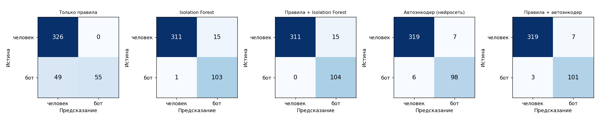

# Детектор low-and-slow ботов по журналам Apache

Курсовой проект по дисциплине «Междисциплинарный проектный практикум».

Система находит в журнале Apache (формат `combined`) **медленных ботов**:
тех, кто делает один запрос в десятки секунд или минут, чтобы не попасть
под ограничения частоты. Используются два подхода:

- **правила** — проверка поисковых роботов по DNS, невозможные User-Agent,
  слишком равномерные интервалы, всплески IP одной подсети;
- **машинное обучение** — нейросетевой автоэнкодер (PyTorch) и Isolation
  Forest (scikit-learn) оценивают, насколько поведение IP отличается от
  обычных посетителей, и объясняют, какими признаками.

| Метод (тестовая выборка) | Precision | Recall | F1 |
|---|---|---|---|
| Только правила | 1.000 | 0.529 | 0.692 |
| Автоэнкодер | 0.933 | 0.942 | 0.938 |
| **Правила + автоэнкодер** | **0.935** | **0.971** | **0.953** |

Подробности — в [docs/04_testing.md](docs/04_testing.md).



## Установка

```bash
python -m venv .venv
.venv\Scripts\activate          # Linux/macOS: source .venv/bin/activate
pip install -r requirements.txt
```

Нужен Python 3.10+. Для PyTorch без видеокарты можно поставить CPU-версию:
`pip install torch --index-url https://download.pytorch.org/whl/cpu`.

## Быстрый старт на демо-журнале

В репозитории нет реальных журналов: в них IP-адреса и история посещений
покупателей. Вместо этого есть полностью синтетический журнал вымышленного
магазина с разметкой ботов (`data/demo/`) и модели, обученные на нём.

```bash
python -m lsdetector detect data/demo/demo_access.log --dns-offline --models-dir models/demo --json output/demo.json
```

```
Строк: 20773, разобрано: 20773, уникальных IP: 374
Модели: iforest, autoencoder
Подозрительных IP: 64
  model:autoencoder  аномальное поведение (модель)                  32
  rule6              много IP одной подсети в коротком окне         23
  rule5              аномально равномерные интервалы                 9
```

## Работа со своим журналом

```bash
# 1. обучить модели под свой сайт и получить метрики и графики
python -m lsdetector train access.log

# 2. найти ботов
python -m lsdetector detect access.log -o suspicious_ips.txt --json report.json
```

`train` внедряет в журнал синтетических ботов (`lsdetector/simulate.py`),
обучает модели на обычных посетителях, подбирает порог и сохраняет модели
в `models/pretrained/`, а метрики и графики — в `output/evaluation/`.

Основные параметры `detect`:

| Параметр | Значение |
|---|---|
| `--dns-cache FILE` | кэш DNS (по умолчанию `dns_cache.json`) |
| `--dns-offline` | не проверять поисковиков по DNS |
| `--all-rules` | проверять все правила, даже если сработало правило 1 |
| `--whitelist FILE` | CIDR-сети, исключаемые из правила 6 |
| `--subnet-window`, `--subnet-threshold`, `--subnet-prefix` | правило 6 |
| `--cv-threshold` | порог коэффициента вариации (правило 5) |
| `--models-dir DIR`, `--decision-model NAME`, `--no-ml` | модели |

Другие команды: `simulate` (журнал с внедрёнными ботами), `demo`
(новый демо-журнал), `sample` (обезличенный фрагмент журнала для
локальной работы).

## Веб-интерфейс и REST API

```bash
uvicorn api.main:app --port 8000
```

- страница: http://127.0.0.1:8000/ — загрузка журнала, сводка, графики,
  таблица IP с фильтрами, выгрузка JSON;
- Swagger: http://127.0.0.1:8000/docs.

Для демо-журнала запускайте с демо-моделями: переменная окружения
`LSD_MODELS_DIR=models/demo`.

## Правила

| № | Правило | Тип |
|---|---|---|
| 1 | Заявленный поисковый бот (Google, Yandex, Bing) не подтверждён reverse + forward DNS | надёжное |
| 2 | Несколько разных пар (браузер, ОС) на одном IP | слабое, только в отчёт |
| 3 | Невозможный User-Agent: несуществующая версия, несовместимые ОС и браузер, средства автоматизации | надёжное |
| 5 | Слишком равномерные интервалы между визитами (CV < 0.15) | надёжное |
| 6 | ≥ 5 разных IP одной /24 в окне 10 минут | надёжное |

## Структура

```
lsdetector/   ядро: разбор, правила, признаки, модели, оценка, CLI
api/          REST API (FastAPI)
web/          веб-страница
models/       обученные модели
data/demo/    синтетический журнал с разметкой
tests/        тесты (pytest)
docs/         документация по этапам курсового проекта
```

## Документация

1. [Анализ предметной области и требования](docs/01_requirements.md)
2. [Проектирование](docs/02_architecture.md)
3. [Реализация](docs/03_implementation.md)
4. [Тестирование и оценка качества](docs/04_testing.md)

## Тесты

```bash
pip install -r requirements-dev.txt
pytest -q
```
