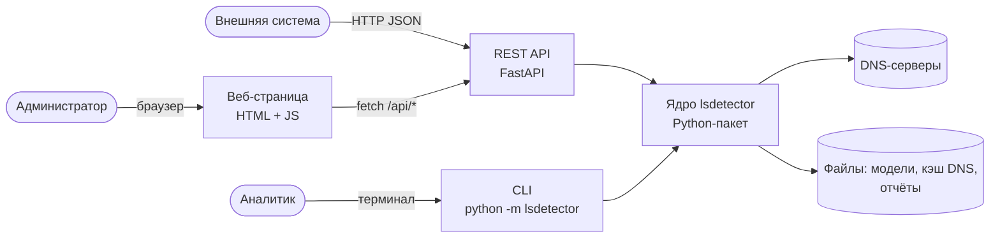
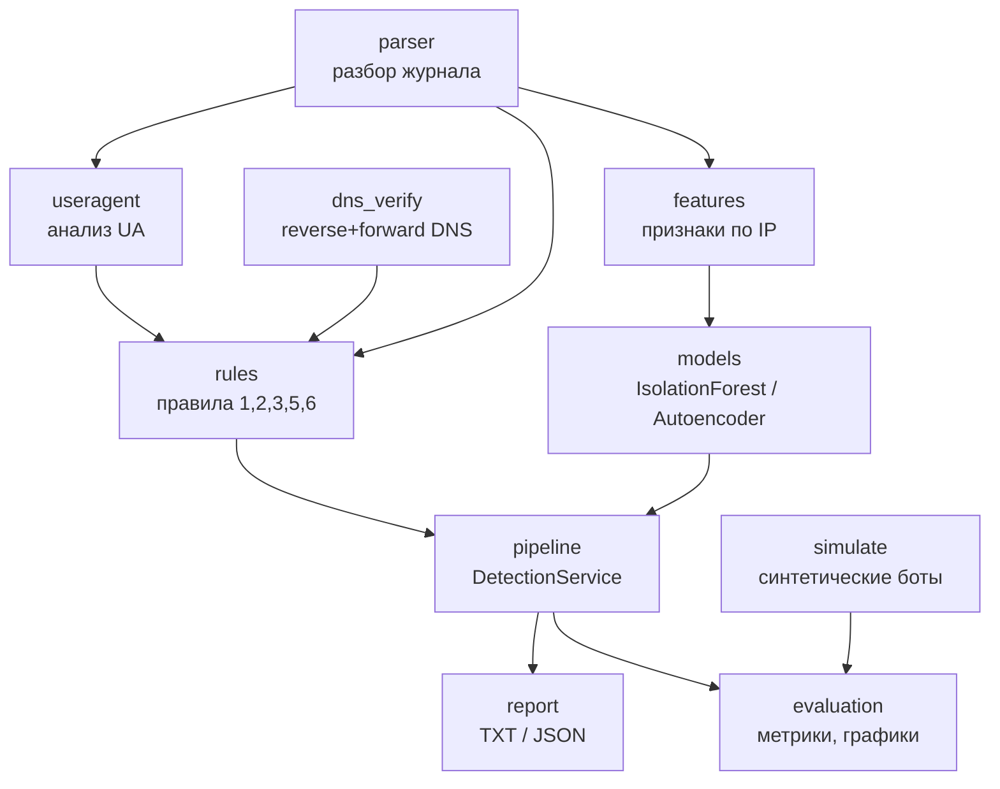
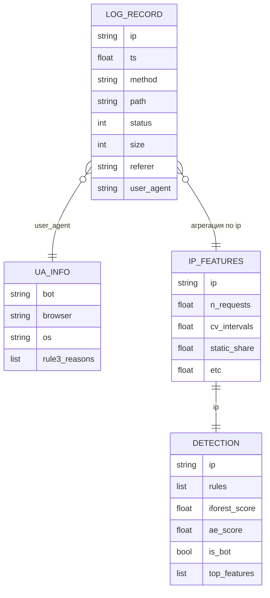

# Этап 2. Проектирование

## 2.1. Архитектура (C4)

### Контейнеры (C2)



### Компоненты ядра (C3)



Связи построены так, чтобы каждый модуль зависел только от «нижних»:
`parser` ничего не знает о правилах, правила — о моделях, а
`DetectionService` собирает всё вместе.

## 2.2. Модель данных

Данные хранятся в файлах, БД не требуется: журнал обрабатывается целиком за
один проход, а результаты — это отчёт по одному прогону.



## 2.3. ML-пайплайн

1. **Сбор данных.** Журнал Apache интернет-магазина за один день
   (395 тыс. строк, 6,7 тыс. IP). Журнал содержит реальные IP, поэтому
   в репозиторий кладётся только обезличенная выборка (`data/sample/`).
2. **Предобработка.** Отбрасываются нераспознанные строки, IP
   нормализуются, записи каждого IP сортируются по времени. IP с менее чем
   `min_requests` запросами в модель не подаются — по ним нельзя оценить
   поведение.
3. **Признаки.** Для каждого IP считается 21 признак: интенсивность,
   регулярность интервалов (CV, медиана, энтропия), доля статики, ошибок,
   POST, пустого Referer, разнообразие путей и User-Agent, ночная доля и т. д.
   Счётчики логарифмируются (`log1p`), затем стандартизируются
   (`StandardScaler`).
4. **Разметка.** Настоящей разметки нет, поэтому используются два источника:
   - *синтетические боты*: генератор `simulate` внедряет в журнал IP
     с известным поведением low-and-slow (метка 1), все остальные IP — 0;
   - *слабая разметка*: IP, найденные надёжными правилами (1, 3, 5),
     используются для анализа согласованности модели и правил.
5. **Разбиение.** IP делятся на train / validation / test в пропорции
   60 / 20 / 20 со стратификацией по метке. Модели без учителя обучаются
   только на train-IP с меткой 0 (подтверждённые правилами боты исключаются).
6. **Модели.** Рассмотрены:
   - Isolation Forest — быстрый базовый метод поиска аномалий;
   - One-Class SVM — плохо масштабируется и чувствителен к `gamma`;
   - Local Outlier Factor — не умеет оценивать новые данные без переобучения;
   - **автоэнкодер (PyTorch)** — нейросеть, которая учится восстанавливать
     признаки обычных посетителей; ошибка восстановления служит оценкой
     аномальности. Выбран как основная модель: нелинейный, обучается только
     на «нормальных» данных, позволяет показать вклад каждого признака.
7. **Порог.** Порог оценки подбирается на validation по максимуму F1.
8. **Итоговое решение.** IP — бот, если сработало надёжное правило
   (1, 3, 5, 6) **или** оценка модели выше порога. Правило 2 — слабый сигнал,
   оно идёт в отчёт, но не решает само по себе.
9. **Оценка.** На test считаются Precision, Recall, F1, ROC-AUC,
   строятся матрица ошибок, ROC- и PR-кривые, распределение оценок.

## 2.4. Интерфейс пользователя

Одна страница:

```
+---------------------------------------------------------------+
| Детектор low-and-slow ботов                                    |
| [Выбрать файл access.log] [Анализировать]   Модель: [AE v]     |
+---------------------------------------------------------------+
| Строк: 395000 | IP: 6706 | Подозрительных: 2600 | Время: 12 с  |
+---------------------------------------------------------------+
| [гистограмма оценок]          | [распределение по правилам]   |
+---------------------------------------------------------------+
| Фильтр: [IP...] [Только боты v] [Правило: все v]               |
| IP            | Правила | AE   | IF   | Решение | Признаки     |
| 1.2.3.4       | 1       | 0.93 | 0.71 | бот     | cv, static   |
+---------------------------------------------------------------+
```

Сценарий: выбрать файл → «Анализировать» → сводка и графики → фильтрация
таблицы → «Скачать JSON».
