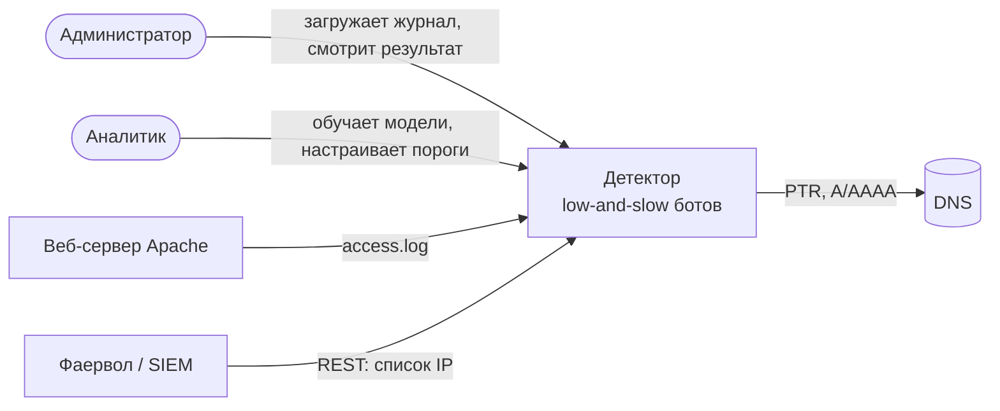
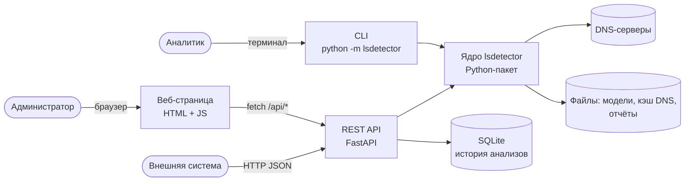
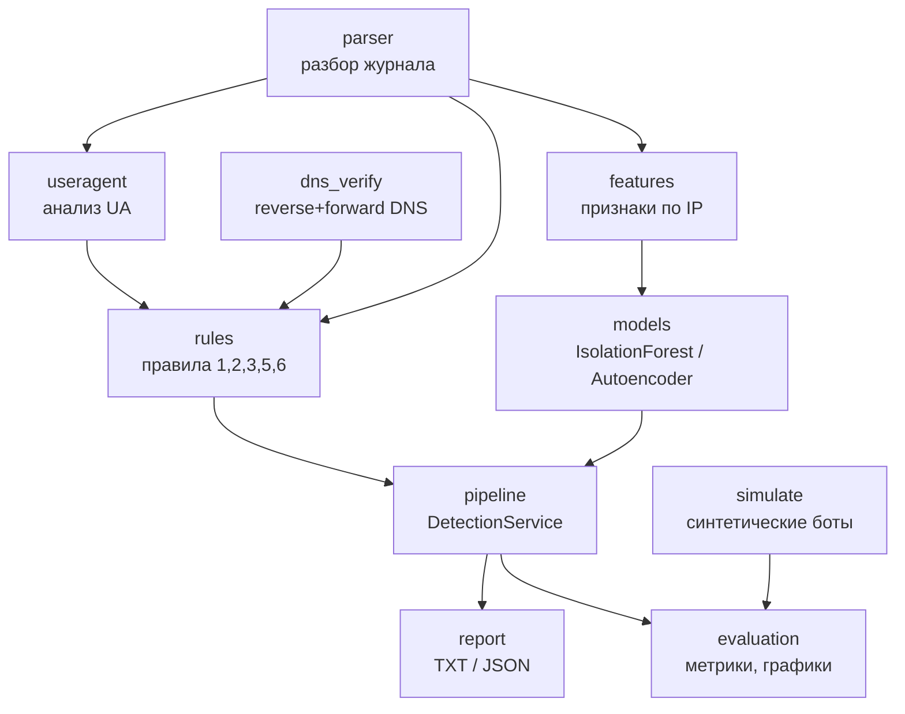
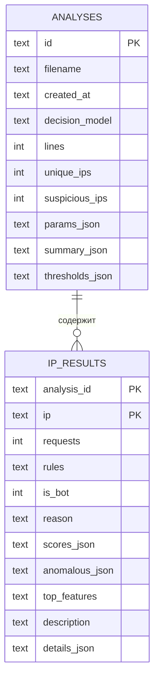
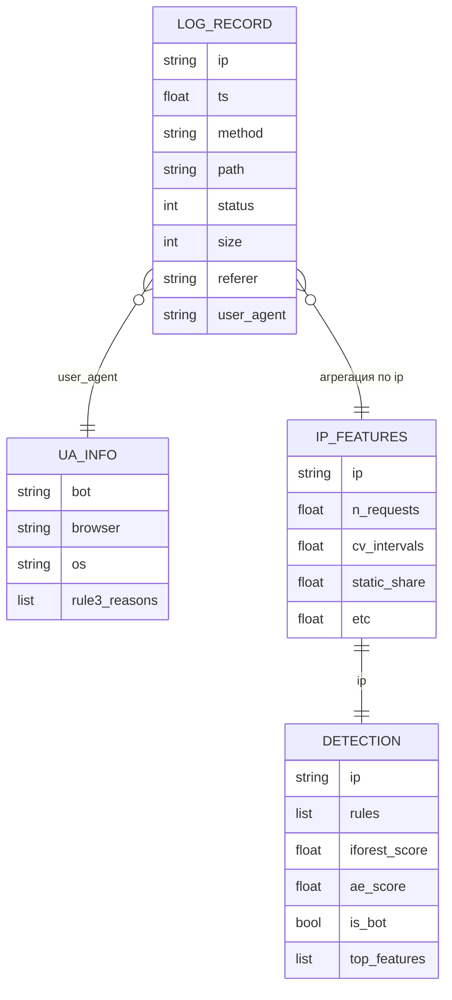

# Этап 2. Проектирование

## 2.1. Архитектура (C4)

Архитектурный стиль — **клиент-серверный модульный монолит**: одно ядро
(Python-пакет) и два тонких интерфейса к нему (REST API и CLI). Для
офлайн-анализа журналов микросервисы избыточны: нет независимо
масштабируемых частей, а один процесс проще развернуть администратору.

UML-диаграммы в нотации PlantUML лежат в [docs/uml](uml/): варианты
использования (`use_case.puml`), C4 (`c1_context`, `c2_containers`,
`c3_components`), развёртывание (`deployment`), последовательность
анализа (`sequence_analyze`), классы (`class_diagram`), деятельность
ML-пайплайна (`ml_pipeline`), ER-диаграмма БД (`er_diagram`). Ниже —
упрощённые версии на Mermaid, которые GitHub показывает прямо в браузере.

### Контекст (C1)



### Контейнеры (C2)



### Компоненты ядра (C3)



Связи построены так, чтобы каждый модуль зависел только от «нижних»:
`parser` ничего не знает о правилах, правила — о моделях, а
`DetectionService` собирает всё вместе.

## 2.2. Модель данных

**Концептуальная модель.** Журнал состоит из записей (`LogRecord`),
записи группируются по IP; для IP вычисляются сведения о User-Agent,
признаки и итоговое решение. Решения одного прогона образуют анализ.

**Хранение.** Журнал обрабатывается в памяти за один проход, поэтому
сырые записи в БД не сохраняются. В БД попадает **история анализов**:
сводка прогона и решения по каждому IP. Можно вернуться к прошлому
результату, переслать ссылку на него и посмотреть, как менялось решение
по одному IP между прогонами (`GET /api/ips/{ip}`).

**Выбор СУБД — SQLite.** Встроена в Python (модуль `sqlite3`), не
требует отдельного сервера, база — один файл; нагрузка — один
администратор и редкие запросы внешних систем. Режим WAL позволяет
нескольким процессам uvicorn писать по очереди. Доступ к данным
изолирован в `AnalysisRepository`, поэтому переход на PostgreSQL
затронет только этот класс.

**Физическая модель** — две таблицы, DDL в [api/schema.sql](../api/schema.sql):

| Таблица | Ключ | Назначение |
|---|---|---|
| `analyses` | `id` | один загруженный журнал: файл, дата, модель, число строк/IP/ботов, параметры, сводка, пороги (JSON) |
| `ip_results` | `(analysis_id, ip)`, FK → `analyses.id` `ON DELETE CASCADE` | решение по IP: правила, оценки моделей, флаг «бот», причина, главные признаки, описание |

Индексы: по дате анализа, по `(analysis_id, is_bot)` для выборки только
ботов, по `ip` для истории IP. Вложенные структуры (оценки разных моделей,
подробности правил) хранятся в JSON-полях: их состав зависит от набора
моделей и правил, а поиск по ним не нужен.



Модель данных в памяти (логическая):



## 2.3. ML-пайплайн

1. **Сбор данных.** Журнал Apache интернет-магазина за один день
   (395 тыс. строк, 6,7 тыс. IP). Журнал содержит реальные IP, поэтому
   в репозиторий кладётся только обезличенная выборка (`data/sample/`).
2. **Предобработка.** Отбрасываются нераспознанные строки, IP
   нормализуются, записи каждого IP сортируются по времени. IP с менее чем
   `min_requests` запросами в модель не подаются — по ним нельзя оценить
   поведение.
3. **Признаки.** Для каждого IP считается 21 признак: интенсивность,
   регулярность интервалов (CV, медиана, энтропия), доля статики, ошибок,
   POST, пустого Referer, разнообразие путей и User-Agent, ночная доля и т. д.
   Счётчики логарифмируются (`log1p`), затем стандартизируются
   (`StandardScaler`).
4. **Разметка.** Настоящей разметки нет, поэтому используются два источника:
   - *синтетические боты*: генератор `simulate` внедряет в журнал IP
     с известным поведением low-and-slow (метка 1), все остальные IP — 0;
   - *слабая разметка*: IP, найденные надёжными правилами (1, 3, 5),
     используются для анализа согласованности модели и правил.
5. **Разбиение.** IP делятся на train / validation / test в пропорции
   60 / 20 / 20 со стратификацией по метке. Модели без учителя обучаются
   только на train-IP с меткой 0 (подтверждённые правилами боты исключаются).
6. **Модели.** Сравниваются четыре метода поиска аномалий без учителя
   (все реализованы, результаты — в [04_testing.md](04_testing.md), раздел 4.2):
   - Isolation Forest — ансамбль случайных деревьев, базовый метод;
   - One-Class SVM (RBF) — граница вокруг нормальных данных;
   - Local Outlier Factor (`novelty=True`) — сравнение плотности с соседями;
   - **автоэнкодер (PyTorch)** — нейросеть, которая учится восстанавливать
     признаки обычных посетителей; ошибка восстановления служит оценкой
     аномальности. Выбран как основная модель: лучший средний F1 на пяти
     вариантах данных, самая быстрая оценка, маленький размер модели, а
     ошибка по каждому признаку объясняет решение. Архитектура подобрана
     перебором по F1 на validation (`scripts/experiments.py`).
7. **Порог.** Порог оценки подбирается на validation по максимуму F1.
8. **Итоговое решение.** IP — бот, если сработало надёжное правило
   (1, 3, 5, 6) **или** оценка модели выше порога. Правило 2 — слабый сигнал,
   оно идёт в отчёт, но не решает само по себе.
9. **Оценка.** На test считаются Precision, Recall, F1, ROC-AUC,
   строятся матрица ошибок, ROC- и PR-кривые, распределение оценок.

## 2.4. Выбор технологий

| Задача | Выбрано | Альтернативы | Почему |
|---|---|---|---|
| Язык | Python 3.11 | Go, Java | экосистема ML (pandas, scikit-learn, PyTorch), рекомендован методичкой; скорость разбора достаточна (НФТ-1) |
| Табличные данные | pandas, numpy | polars | стандарт де-факто, совместим со scikit-learn |
| Классические модели | scikit-learn | PyOD | Isolation Forest, OCSVM, LOF, метрики и разбиение в одной библиотеке |
| Нейросеть | PyTorch | TensorFlow / Keras | простой собственный цикл обучения (ранняя остановка, ошибка по признакам), CPU-версия без CUDA |
| Сохранение моделей | joblib + `state_dict` | pickle, ONNX | joblib эффективен для массивов numpy; ONNX не нужен — инференс в том же Python |
| REST API | FastAPI + Pydantic | Flask, Django | автоматический Swagger, валидация параметров, обработка запросов в пуле потоков |
| Веб-интерфейс | HTML + JavaScript без фреймворка | React, Vue | одна страница, нет сборки и зависимостей, работает без интернета |
| СУБД | SQLite | PostgreSQL, MongoDB | встроена, без сервера; нагрузка одного администратора |
| Графики | matplotlib (отчёты), SVG (веб) | plotly | статичные PNG для записки; в вебе — без внешних библиотек |
| Тесты, стиль | pytest, ruff | unittest, flake8 | фикстуры и параметризация; ruff объединяет линтер и сортировку импортов |
| CI | GitHub Actions | GitLab CI | репозиторий на GitHub |
| Диаграммы | PlantUML (+ Mermaid в Markdown) | draw.io, StarUML | текстовые исходники в Git, единая нотация UML / C4 |

## 2.5. Интерфейс пользователя

Одна страница:

```
+---------------------------------------------------------------+
| Детектор low-and-slow ботов                                    |
| [Выбрать файл access.log] [Анализировать]   Модель: [AE v]     |
+---------------------------------------------------------------+
| Строк: 395000 | IP: 6706 | Подозрительных: 2600 | Время: 12 с  |
+---------------------------------------------------------------+
| [гистограмма оценок]          | [распределение по правилам]   |
+---------------------------------------------------------------+
| История: дата | файл | модель | строк | IP | ботов | открыть    |
+---------------------------------------------------------------+
| Фильтр: [IP...] [Только боты v] [Правило: все v]               |
| IP            | Правила | AE   | IF   | Решение | Признаки     |
| 1.2.3.4       | 1       | 0.93 | 0.71 | бот     | cv, static   |
+---------------------------------------------------------------+
```

Сценарий: выбрать файл → «Анализировать» → сводка и графики → фильтрация
таблицы → «Скачать JSON». Прошлые анализы открываются из таблицы истории;
ссылка вида `/#id=<id>` открывает конкретный результат.
