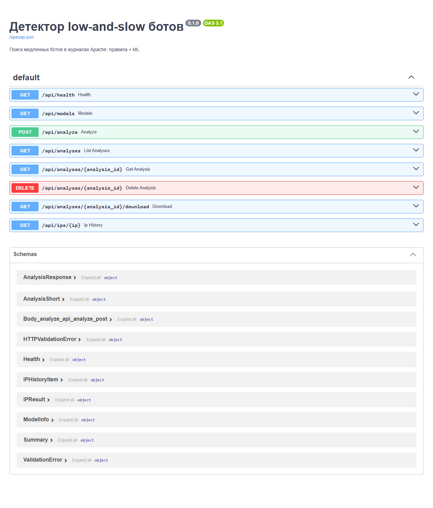
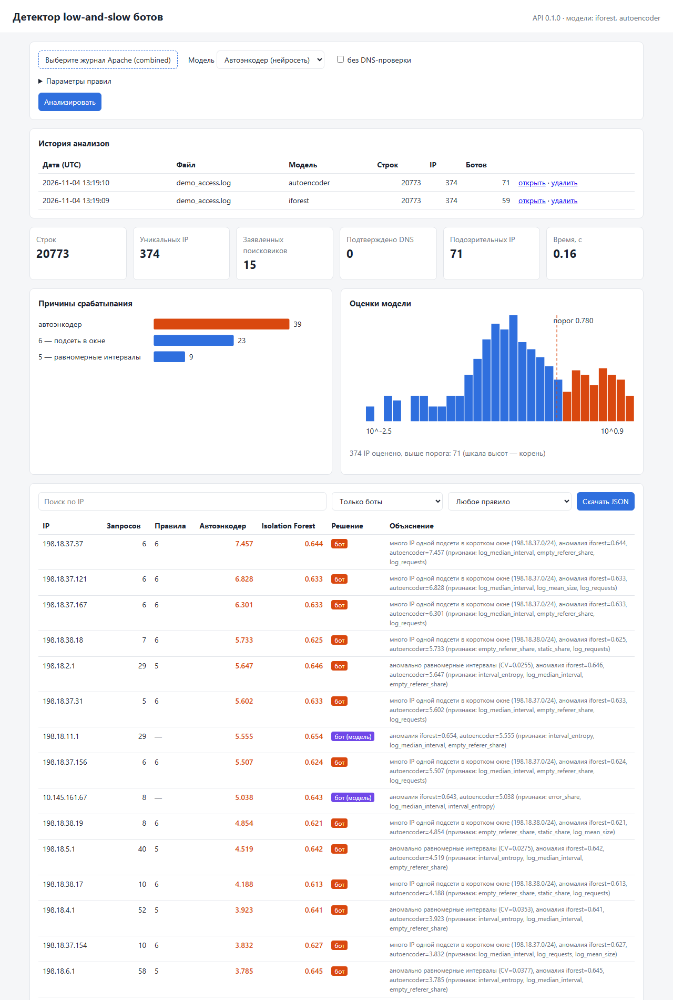

# Этап 4. Тестирование и оценка качества

## 4.1. Тест-план

| Уровень | Что проверяется | Файл |
|---|---|---|
| Unit | разбор строк, время с часовым поясом, IPv6, статистика пропусков | `tests/test_parser.py` |
| Unit | 13 проверок правдоподобия User-Agent, исключения для ботов и Яндекс.Браузера | `tests/test_useragent.py` |
| Unit | правила 1–6 с поддельным DNS, белый список, приоритет правила 1 | `tests/test_rules.py` |
| Unit | признаки, разбиение выборок, подбор порога, обучение и сохранение всех 4 моделей, отчёт оценки | `tests/test_ml.py` |
| Unit | хранилище SQLite: сохранение, история, каскадное удаление | `tests/test_storage.py` |
| Интеграционный | DetectionService, CLI `detect`, REST API (успех и ошибки), история, веб-страница | `tests/test_pipeline_api.py` |
| Нагрузочный | параллельные запросы к API | `scripts/load_test.py`, см. 4.5 |
| Производительность | полный журнал 395 тыс. строк | вручную, см. 4.5 |

Запуск: `pytest -q` — 64 теста, ~11 с. Тесты используют только
синтетический журнал и поддельный DNS, поэтому работают без сети и
реальных данных. В GitHub Actions на каждый push запускаются `ruff` и
`pytest`.

## 4.2. Оценка ML-компонента

**Данные:** журнал магазина за 08.09.2026 (395 000 строк, 6 706 IP) +
516 синтетических ботов. В модель попадают IP с ≥ 5 запросами (2 770),
разбиение 60/20/20 со стратификацией по типу бота.

**Тестовая выборка:** 104 синтетических бота и 326 реальных IP, на которых
не сработало ни одно надёжное правило. Поэтому точность «только правил»
на ней равна 1 по построению: реальные IP, пойманные правилами, в
тестовую выборку не входят, а оцениваются отдельно (согласованность ниже).

### Сравнение алгоритмов

Чтобы выбор модели не зависел от одного удачного разбиения, сравнение
повторено на пяти вариантах внедрения ботов (seed 1–5), для каждого
заново строятся выборки, обучаются модели и подбирается порог
(`python scripts/experiments.py access.log`):

| Модель | Precision | Recall | F1 | ROC-AUC | F1 с правилами | Обучение, с | Оценка 1000 IP, мс | Размер, КБ |
|---|---|---|---|---|---|---|---|---|
| Isolation Forest | 0.838 | 0.981 | 0.904 ± 0.013 | 0.965 ± 0.007 | 0.913 | 0.35 | 63.0 | 3407 |
| **Автоэнкодер (нейросеть)** | **0.850** | **1.000** | **0.919 ± 0.017** | **0.969 ± 0.010** | **0.919** | 3.98 | **2.5** | **15** |
| One-Class SVM | 0.800 | 0.959 | 0.872 ± 0.012 | 0.969 ± 0.004 | 0.893 | 0.01 | 7.0 | 16 |
| Local Outlier Factor | 0.813 | 0.996 | 0.895 ± 0.022 | 0.950 ± 0.016 | 0.895 | 0.04 | 26.1 | 331 |

Автоэнкодер даёт лучший средний F1 и полноту, а по ROC-AUC делит первое
место с One-Class SVM. Отрыв от Isolation Forest по F1 (0.919 против
0.904) сравним с разбросом между сидами, поэтому решающими стали и
практические свойства: оценка в 25 раз быстрее Isolation Forest, модель
весит 15 КБ против 3,4 МБ, а ошибка восстановления по каждому признаку
объясняет решение. Обучение дольше (4 с), но выполняется редко.

### Подбор гиперпараметров автоэнкодера

Перебор 18 архитектур (скрытые слои × размер латентного слоя × dropout),
выбор — по F1 на validation; полная таблица — в
[experiments/experiments.md](experiments/experiments.md). Лучшие:

| Скрытые слои | Латентный | Dropout | F1 (val) | Эпох | F1 (test) | ROC-AUC (test) |
|---|---|---|---|---|---|---|
| **16-8** | **3** | **0.0** | **0.928** | 300 | 0.963 | 0.990 |
| 16-8 | 3 | 0.1 | 0.924 | 184 | 0.972 | 0.989 |
| 16-8 | 6 | 0.0 | 0.920 | 183 | 0.954 | 0.989 |
| 32-16 | 10 | 0.1 | 0.920 | 288 | 0.959 | 0.983 |
| 64-32 | 3 | 0.0 | 0.833 | 255 | 0.869 | 0.962 |

Узкая сеть (21 → 16 → 8 → **3** → 8 → 16 → 21) работает лучше широкой:
широкая (64-32) успевает научиться восстанавливать и необычные векторы, и
ошибка ботов перестаёт отличаться от ошибки людей. Первоначальная
архитектура 32-16-6 (F1 на validation 0.904) заменена на 16-8-3.
Прочие гиперпараметры: Adam (lr 1e-3, weight_decay 1e-5), MSE,
batch 128, до 300 эпох, ранняя остановка с patience 25.

### Итоговая модель (seed = 42)

| Метод | Precision | Recall | F1 | ROC-AUC |
|---|---|---|---|---|
| Только правила | 1.000 | 0.529 | 0.692 | — |
| Isolation Forest | 0.866 | 0.990 | 0.924 | 0.970 |
| Правила + Isolation Forest | 0.867 | 1.000 | 0.929 | — |
| Автоэнкодер (нейросеть) | 0.929 | 1.000 | 0.963 | 0.990 |
| **Правила + автоэнкодер** | **0.929** | **1.000** | **0.963** | — |

Целевые метрики НФТ-2 (F1 ≥ 0.85, Precision ≥ 0.9) достигнуты
комбинацией «правила + автоэнкодер». На пяти сидах средняя точность
автоэнкодера ниже — 0.85, — поэтому требование к точности выполняется не
на каждом варианте данных; это учтено в анализе ошибок.

Полнота по типам ботов:

| Тип | Правила | Isolation Forest | Автоэнкодер | Правила + АЭ |
|---|---|---|---|---|
| timer | 0.55 | 1.00 | 1.00 | 1.00 |
| random_slow | 0.00 | 1.00 | 1.00 | 1.00 |
| distributed | 1.00 | 0.98 | 1.00 | 1.00 |
| mimic | 0.00 | 1.00 | 1.00 | 1.00 |

Правила ловят только ботов с явным признаком (таймер — правило 5,
группа в подсети — правило 6), а ботов со случайными интервалами и
подгрузкой статики пропускают полностью. Модели находят их по
поведению.

**Согласованность с правилами:** из 124 реальных IP тестовой выборки,
найденных правилами (в основном поддельные Googlebot/YandexBot),
автоэнкодер сам считает аномальными 96,0 %, Isolation Forest — 97,6 %,
хотя эти IP в обучении не участвовали.


## 4.3. Анализ ошибок

Разбор ошибок сохраняется в `output/evaluation/errors.csv`.

- **Пропуски.** Автоэнкодер на тестовой выборке ботов не пропустил.
  Isolation Forest пропустил одного бота `distributed`: у него всего
  несколько запросов, и по признакам он похож на случайного посетителя;
  его ловит правило 6.
- **Ложные срабатывания автоэнкодера (8 из 326 реальных IP).** Чаще всего
  в главных признаках `query_share`, `unique_path_ratio`,
  `empty_referer_share`, `log_user_agents`, `n_browser_os`: это посетители,
  которые активно пользуются поиском и фильтрами, приходят по прямым
  ссылкам без Referer или сидят за одним NAT с другими. Один IP с
  наибольшей оценкой (3.3) выделяется долей ответов 5xx — это скорее сбой
  на стороне сервера, чем бот. Часть таких IP может быть и настоящими
  ботами, которых не ловят правила, — без ручной разметки это не
  проверить. Поэтому в отчёте для каждого IP указаны главные признаки, а
  решение о блокировке остаётся за администратором.
- **Ограничение оценки.** Синтетические боты построены по нашему же
  представлению о low-and-slow поведении, поэтому метрики на них
  оптимистичны. Модели обучаются под конкретный сайт: модели, обученные на
  журнале магазина, на демо-журнале вымышленного сайта давали сотни ложных
  срабатываний; после обучения на нём (`train --labels`) — 12 из 315 IP при
  найденных 59 из 59 ботов.

## 4.4. Найденные и исправленные ошибки

| Ошибка | Как найдена | Исправление |
|---|---|---|
| В прототипе проверки User-Agent 3h–3m стояли после `return` и не выполнялись, ссылались на неопределённые константы | ревью кода при переносе в модуль | перенесены до `return`, добавлены таблицы, тесты на каждую проверку |
| Проверка 3h срабатывала на Chrome для iOS (CriOS) и приложения Яндекса | прогон на реальном журнале | исключения `CriOS`, `YaApp`, `YaSearch` и др. |
| Проверка 3i дала 229 ложных срабатываний | прогон на реальном журнале | помечена как слабая: только в отчёт |
| Стратифицированное разбиение падало на маленьком журнале (группы из 1 IP) | обучение на демо-журнале | редкие группы объединяются, при необходимости — без стратификации |
| Подобранный порог исключал IP, на оценке которого он стоит (`>=` в `precision_recall_curve` против `>` в детекторе) | расхождение счётчиков в веб-интерфейсе | порог ставится между соседними оценками, регрессионный тест |
| Веб-страница считала «выше порога» по округлённым оценкам | там же | счётчик по флагу `anomalous` из API |
| Анализы в API выполнялись строго по очереди: блокировка кэша DNS охватывала весь анализ | нагрузочный тест | блокировка только на чтение и запись файла кэша |
| `database is locked` при нескольких процессах uvicorn | нагрузочный тест с `--workers 4` | SQLite в режиме WAL, тайм-аут ожидания 30 с |

## 4.5. Производительность и нагрузочное тестирование

**Полный журнал** (395 тыс. строк, 150 МБ), правила + обе модели, DNS из
кэша: **20 с** (ноутбук, 8 логических ядер). Требование НФТ-1 (≤ 60 с)
выполнено. Первый прогон с DNS-проверкой 2 955 заявленных ботов — около
3 минут (50 потоков).

**API** (`scripts/load_test.py`, демо-журнал 20 773 строки / 4,9 МБ,
24 запроса `POST /api/analyze` на каждый уровень параллельности):

| Процессов uvicorn | Параллельных запросов | Успешно | Запросов/с | p50, с | p95, с |
|---|---|---|---|---|---|
| 1 | 1 | 24 / 24 | 1.26 | 0.77 | 0.86 |
| 1 | 4 | 24 / 24 | 1.35 | 2.95 | 3.65 |
| 1 | 8 | 24 / 24 | 1.33 | 5.90 | 8.97 |
| 4 | 1 | 24 / 24 | 1.37 | 0.72 | 0.79 |
| 4 | 4 | 24 / 24 | 3.06 | 0.73 | 1.50 |
| 4 | 8 | 24 / 24 | 3.13 | 1.88 | 6.09 |

В одном процессе пропускная способность не растёт с числом потоков:
разбор журнала и признаки — код на чистом Python, и GIL не даёт им
выполняться параллельно. Масштабирование — несколькими процессами
(`uvicorn --workers N`): с 4 процессами пропускная способность выросла в
2,3 раза. На Windows часть воркеров uvicorn может не запуститься
(`WinError 10022`), на Linux такой проблемы нет.

## 4.6. Функциональное тестирование

### API

Swagger (`/docs`) описывает все 8 эндпоинтов и схемы данных:



```bash
curl -F "file=@data/demo/demo_access.log" "http://127.0.0.1:8000/api/analyze?dns_offline=true"
```

Ответ (сокращён; API запущен с `LSD_MODELS_DIR=models/demo`):

```json
{"decision_model": "autoencoder",
 "summary": {"lines": 20773, "unique_ips": 374, "suspicious_ips": 71,
             "by_reason": {"model:autoencoder": 39, "rule6": 23, "rule5": 9}},
 "ips": [{"ip": "198.18.2.1", "requests": 29, "rules": [5], "is_bot": true, "reason": "rule5",
          "description": "аномально равномерные интервалы (CV=0.0255), аномалия iforest=0.646, autoencoder=5.647 (признаки: interval_entropy, log_median_interval, empty_referer_share)"}]}
```

| Сценарий | Ожидаемый результат | Тест |
|---|---|---|
| Загрузка журнала | 200, сводка, IP с описаниями | `test_api_analyze_flow` |
| Результат сохраняется и открывается повторно | тот же список IP, модель | `test_api_analyze_flow` |
| История анализов и история IP | новый анализ первым; IP найден | `test_api_analyze_flow` |
| Удаление анализа | 204, затем 404; история IP пуста | `test_api_analyze_flow` |
| Файл не в формате Apache | 422 | `test_api_errors` |
| Недопустимый параметр (`cv_threshold=5`) | 422 с описанием от Pydantic | `test_api_errors` |
| Неизвестный анализ | 404 | `test_api_errors` |

### Веб-интерфейс



Проверено вручную: загрузка файла, сводка, график причин и гистограмма
оценок с порогом, таблица с поиском, фильтрами «только боты / найдены
только моделью / по правилу» и сортировкой, выгрузка JSON, история
анализов (открыть / удалить), открытие результата по ссылке `/#id=…`.

### Соответствие функциональным требованиям

| Требование | Где реализовано | Проверка |
|---|---|---|
| ФТ-1 разбор журнала | `parser.py` | `test_parser.py` |
| ФТ-2 DNS-проверка поисковиков | `dns_verify.py`, правило 1 | `test_rules.py` |
| ФТ-3 невозможные UA | `useragent.py`, правило 3 | `test_useragent.py` |
| ФТ-4 равномерные интервалы | правило 5 | `test_rules.py` |
| ФТ-5 подсеть в окне | правило 6 | `test_rules.py` |
| ФТ-6 смена браузера/ОС | правило 2 | `test_rules.py` |
| ФТ-7 признаки (≥ 15) | `features.py`, 21 признак | `test_ml.py` |
| ФТ-8 обучение, сохранение, загрузка моделей | `models/`, `training.py` | `test_ml.py` |
| ФТ-9 оценка и итоговое решение | `pipeline.py` | `test_pipeline_api.py` |
| ФТ-10 синтетические боты | `simulate.py`, `demo.py` | `test_ml.py` |
| ФТ-11 метрики и графики | `evaluation.py` | `test_ml.py` |
| ФТ-12 TXT и JSON | `report.py`, CLI | `test_cli_detect` |
| ФТ-13 REST API | `api/` | `test_pipeline_api.py` |
| ФТ-14 веб-страница | `web/` | `test_web_page`, вручную |
| ФТ-15 белый список | правило 6, `--whitelist` | `test_rule6_whitelist` |
| ФТ-16 история анализов | `api/storage.py`, SQLite | `test_storage.py`, `test_api_analyze_flow` |

## 4.7. Оценка эффективности (AS-IS / TO-BE)

| | AS-IS (прототип) | TO-BE (система) |
|---|---|---|
| Методы | 5 правил | правила + нейросетевой автоэнкодер (+ 3 модели для сравнения) |
| Полнота на low-and-slow ботах | 0.53 | 1.00 |
| Точность | 1.00 | 0.93 |
| Объяснение | номер правила | правило + главные признаки модели |
| Интерфейс | CLI | CLI, REST API, веб-страница |
| Хранение результатов | файл | SQLite: история анализов и IP |
| Тесты | нет | 64 теста, CI |
| Ошибки в коде | проверки 3h–3m не выполнялись | исправлено, покрыто тестами |

Для администратора это значит: из каждых 100 медленных ботов прототип
находил около 53, система — практически всех, при цене в 8 ложных
срабатываний на 326 обычных IP (2,5 %), каждое из которых
сопровождается объяснением для ручной проверки.
