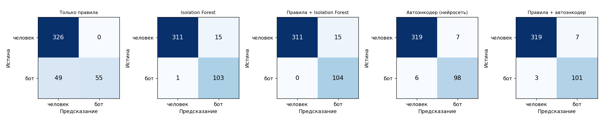
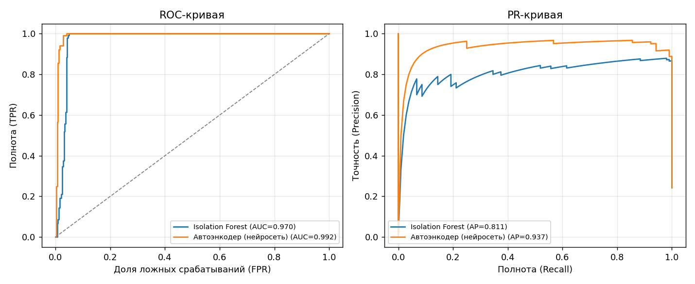
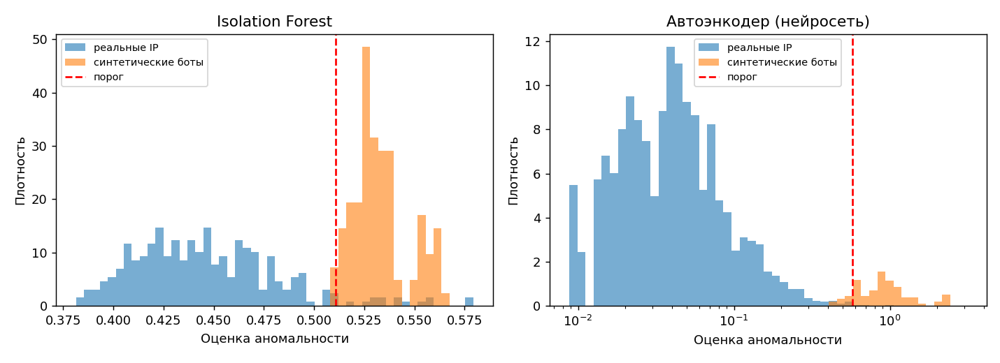
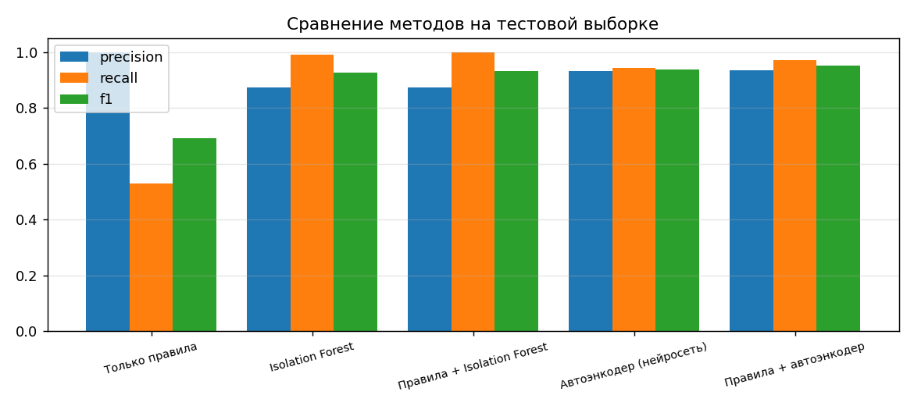
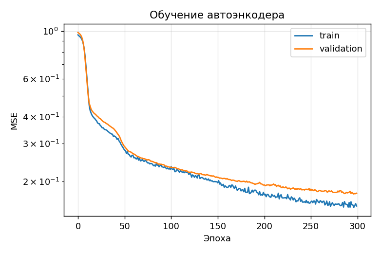
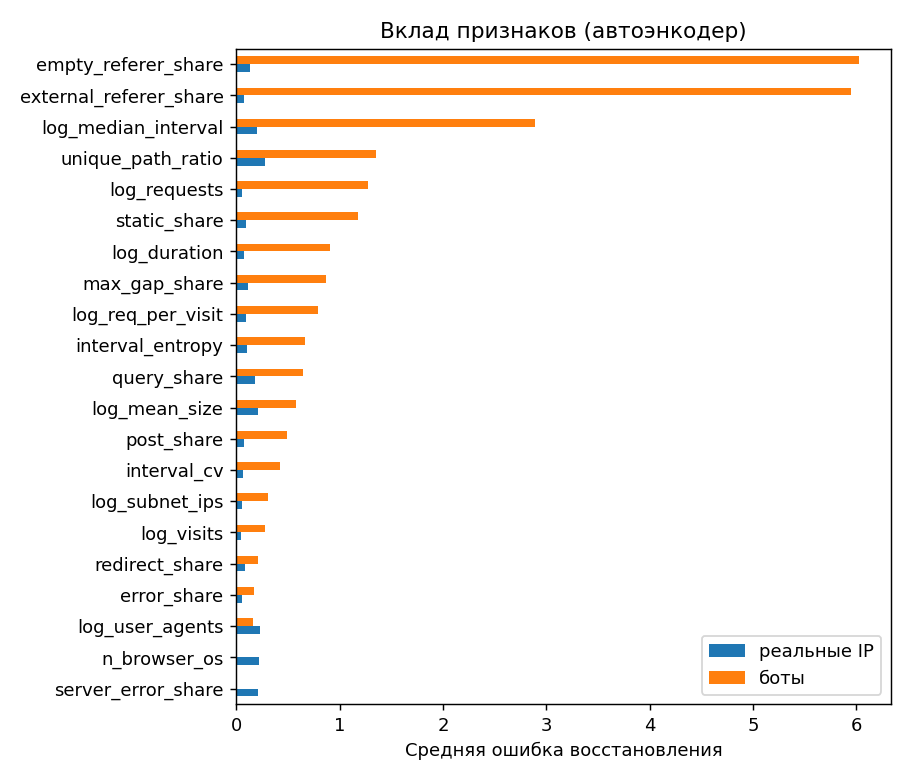

# Этап 4. Тестирование и оценка качества

## 4.1. Тест-план

| Уровень | Что проверяется | Файл |
|---|---|---|
| Unit | разбор строк, время с часовым поясом, IPv6, статистика пропусков | `tests/test_parser.py` |
| Unit | 13 проверок правдоподобия User-Agent, исключения для ботов и Яндекс.Браузера | `tests/test_useragent.py` |
| Unit | правила 1–6 с поддельным DNS, белый список, приоритет правила 1 | `tests/test_rules.py` |
| Unit | признаки, разбиение выборок, подбор порога, сохранение/загрузка обеих моделей | `tests/test_ml.py` |
| Интеграционный | DetectionService, CLI `detect`, REST API (успех и ошибки), веб-страница | `tests/test_pipeline_api.py` |
| Нагрузочный | полный журнал 395 тыс. строк | вручную, см. 4.4 |

Запуск: `pytest -q` — 60 тестов, ~10 с. Тесты используют только
синтетический журнал и поддельный DNS, поэтому работают без сети и
реальных данных.

## 4.2. Оценка ML-компонента

**Данные:** журнал магазина за 08.09.2026 (395 000 строк, 6 706 IP) +
516 синтетических ботов. В модель попадают IP с ≥ 5 запросами (2 770),
разбиение 60/20/20 со стратификацией по типу бота.

**Тестовая выборка:** 104 синтетических бота и 326 реальных IP, на которых
не сработало ни одно надёжное правило.

| Метод | Precision | Recall | F1 | ROC-AUC |
|---|---|---|---|---|
| Только правила | 1.000 | 0.529 | 0.692 | — |
| Isolation Forest | 0.873 | 0.990 | 0.928 | 0.970 |
| Правила + Isolation Forest | 0.874 | 1.000 | 0.933 | — |
| Автоэнкодер (нейросеть) | 0.933 | 0.942 | 0.938 | **0.992** |
| **Правила + автоэнкодер** | **0.935** | 0.971 | **0.953** | — |

Целевые метрики НФТ-2 (F1 ≥ 0.85, Precision ≥ 0.9) достигнуты
комбинацией «правила + автоэнкодер».

Полнота по типам ботов:

| Тип | Правила | Isolation Forest | Автоэнкодер | Правила + АЭ |
|---|---|---|---|---|
| timer | 0.55 | 1.00 | 0.70 | 0.85 |
| random_slow | 0.00 | 1.00 | 1.00 | 1.00 |
| distributed | 1.00 | 0.98 | 1.00 | 1.00 |
| mimic | 0.00 | 1.00 | 1.00 | 1.00 |

Правила ловят только ботов с явным признаком (таймер — правило 5,
группа в подсети — правило 6), а ботов со случайными интервалами и
подгрузкой статики пропускают полностью. Модели находят их по
поведению.

**Согласованность с правилами:** из 124 реальных IP тестовой выборки,
найденных правилами (в основном поддельные Googlebot/YandexBot),
автоэнкодер сам считает аномальными 95,2 %, Isolation Forest — 97,6 %,
хотя эти IP в обучении не участвовали.













## 4.3. Анализ ошибок

Разбор ошибок сохраняется в `output/evaluation/errors.csv`.

- **Пропуски автоэнкодера (6 ботов `timer`).** Это боты с длинным периодом
  (несколько минут) и небольшим числом визитов: их признаки близки к
  человеку, который изредка открывает сайт. Три из них ловит правило 5,
  поэтому в комбинации полнота по `timer` — 0.85. Isolation Forest
  находит всех: для него сильнее отличие по `empty_referer_share` и
  `static_share`.
- **Ложные срабатывания автоэнкодера (7 IP).** Типичный набор главных
  признаков — `query_share`, `unique_path_ratio`, `n_browser_os`,
  `log_user_agents`: это пользователи, которые активно пользуются поиском
  и фильтрами, или несколько человек за одним NAT. Часть из них может
  быть и настоящими ботами, которых не ловят правила, — без ручной
  разметки это не проверить. Поэтому в отчёте для каждого IP указаны
  главные признаки, и решение о блокировке остаётся за администратором.
- **Ограничение оценки.** Синтетические боты построены по нашему же
  представлению о low-and-slow поведении, поэтому метрики на них
  оптимистичны. Модели обучаются под конкретный сайт: обученные на журнале
  магазина модели на демо-журнале вымышленного сайта давали много ложных
  срабатываний, после обучения на нём (`train --labels`) — 6 из 315 IP.

## 4.4. Производительность

Полный журнал (395 тыс. строк, 150 МБ), правила + обе модели, DNS из
кэша: **20 с** (ноутбук, 8 логических ядер). Требование НФТ-1 (≤ 60 с) выполнено.
Первый прогон с DNS-проверкой 2 955 заявленных ботов — около 3 минут
(50 потоков).

## 4.5. Функциональное тестирование API

```bash
curl -F "file=@data/demo/demo_access.log" "http://127.0.0.1:8000/api/analyze?dns_offline=true"
```

Ответ (сокращён; API запущен с `LSD_MODELS_DIR=models/demo`):

```json
{"summary": {"lines": 20773, "unique_ips": 374, "suspicious_ips": 64,
             "by_reason": {"model:autoencoder": 32, "rule5": 9, "rule6": 23}},
 "ips": [{"ip": "198.18.0.1", "rules": [5],
          "scores": {"iforest": 0.63544, "autoencoder": 2.1858},
          "is_bot": true, "reason": "rule5",
          "description": "аномально равномерные интервалы (CV=0.0515), аномалия iforest=0.635, autoencoder=2.186 (признаки: interval_entropy, n_browser_os, log_median_interval)"}]}
```

Ошибки: файл не в формате Apache → `422`, неизвестный анализ → `404`,
недопустимые параметры (например, `cv_threshold=5`) → `422` с описанием
от Pydantic.

## 4.6. Оценка эффективности (AS-IS / TO-BE)

| | AS-IS (прототип) | TO-BE (система) |
|---|---|---|
| Методы | 5 правил | правила + 2 ML-модели |
| Полнота на low-and-slow ботах | 0.53 | 0.97 |
| Точность | 1.00 | 0.94 |
| Объяснение | номер правила | правило + главные признаки модели |
| Интерфейс | CLI | CLI, REST API, веб-страница |
| Тесты | нет | 60 тестов, CI |
| Ошибки в коде | проверки 3h–3m не выполнялись | исправлено, покрыто тестами |
