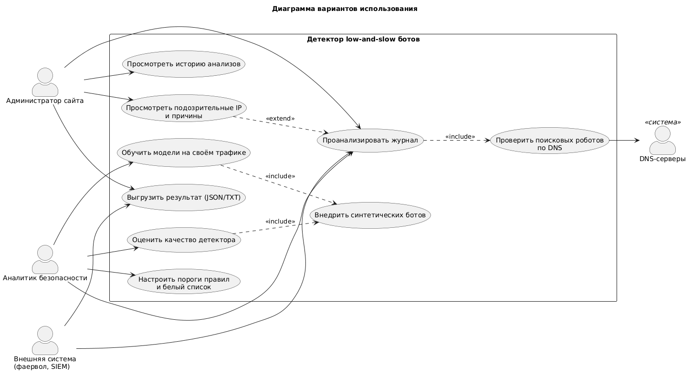
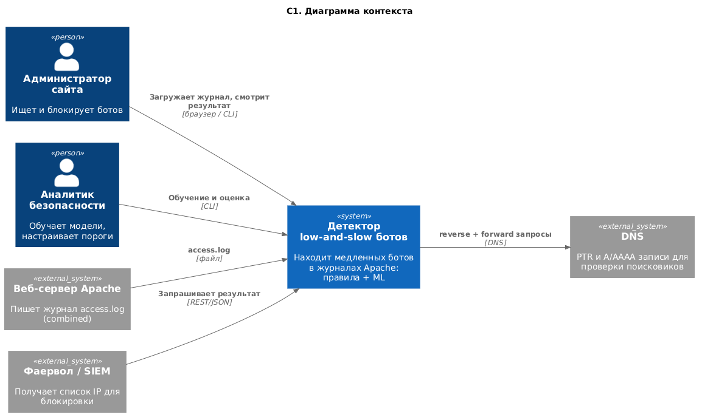
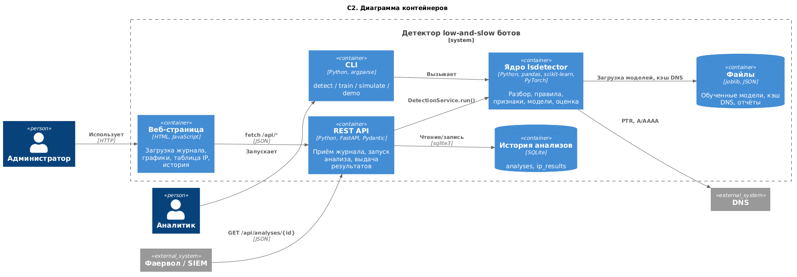
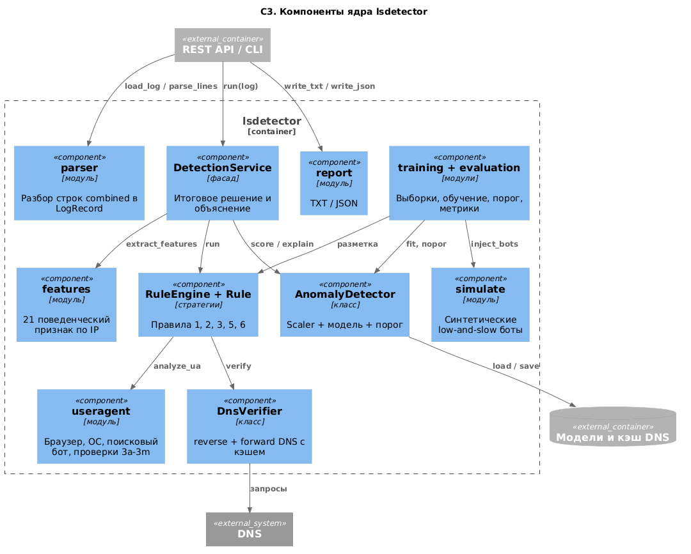
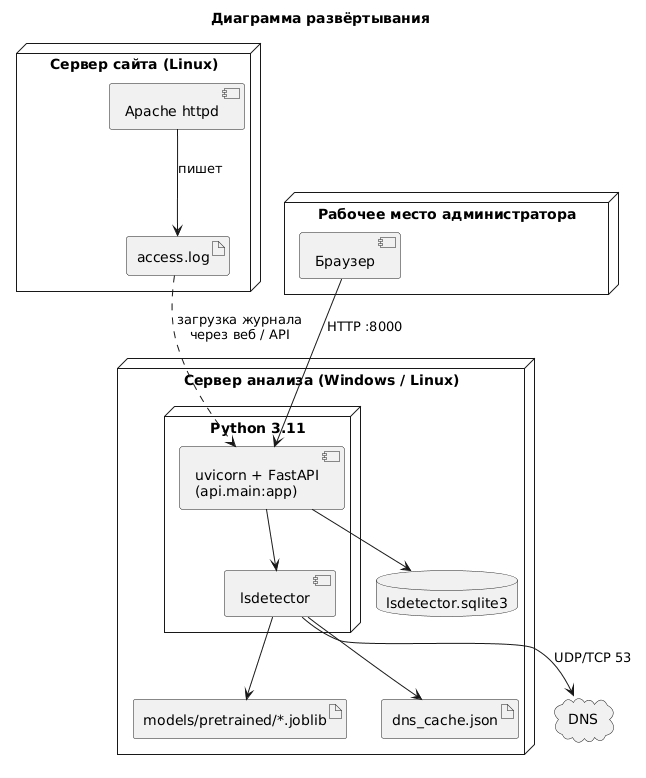
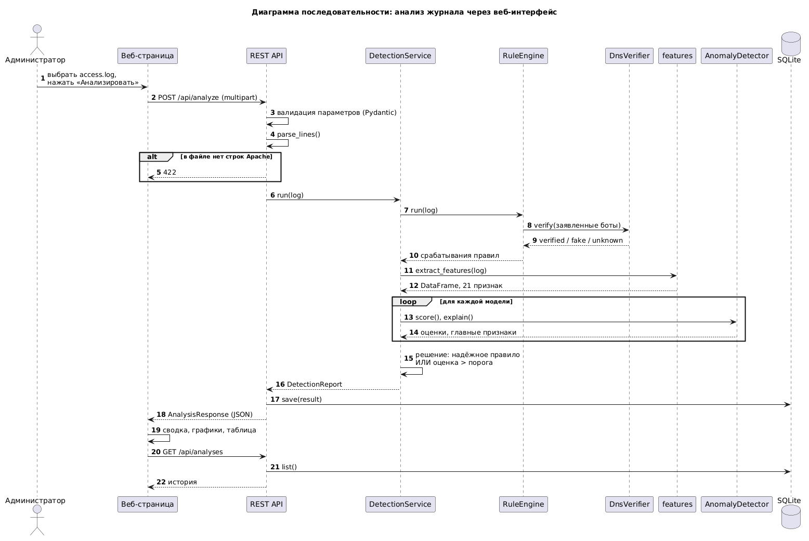
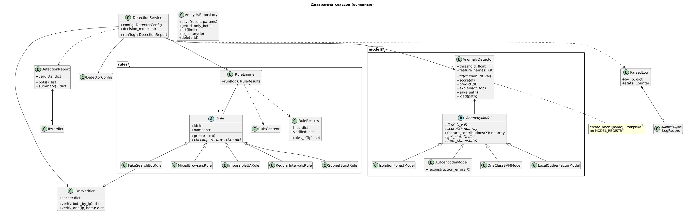
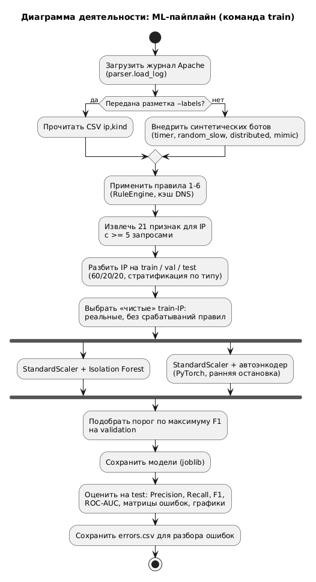
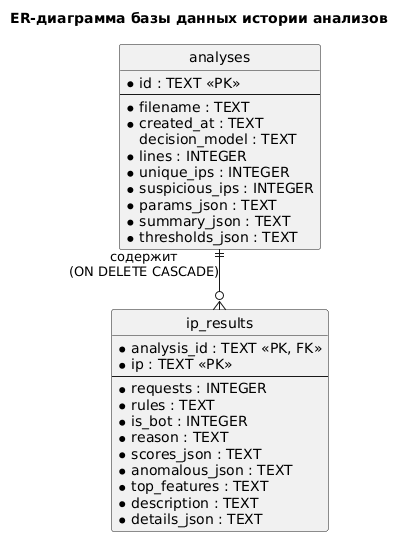

# UML-диаграммы

Исходники — в нотации PlantUML (`*.puml`), PNG получены из них через
[Kroki](https://kroki.io). Чтобы изменить диаграмму, отредактируйте `.puml`
и отрендерите заново (PlantUML-плагин для VS Code / PyCharm, draw.io или
`curl --data-binary @file.puml https://kroki.io/plantuml/png -o file.png`).

## Варианты использования

## C1. Контекст

## C2. Контейнеры

## C3. Компоненты ядра

## Развёртывание

## Последовательность: анализ журнала

## Классы

## Деятельность: ML-пайплайн

## ER-диаграмма БД

